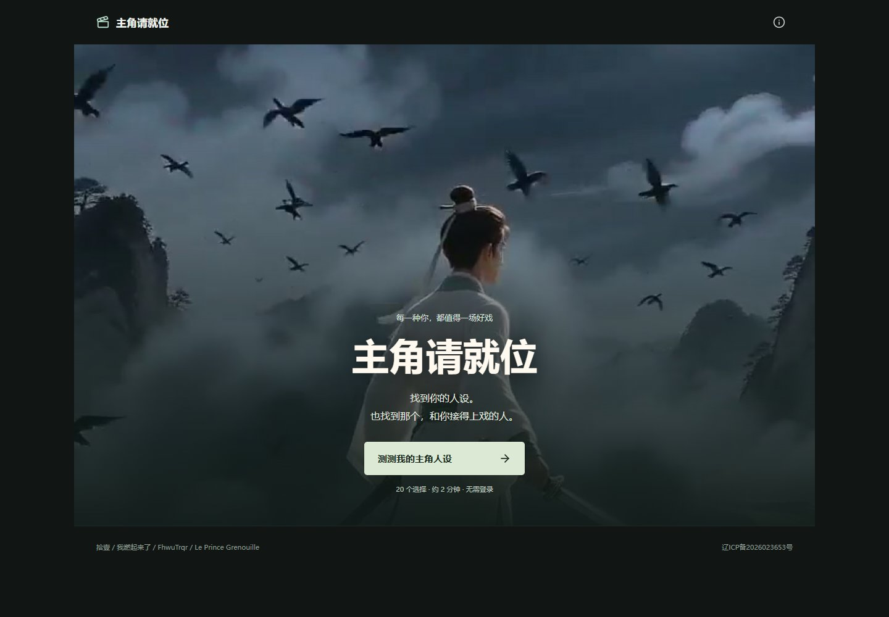

# 主角请就位

40 道日常情境题组成题库，每轮随机抽取 20 道，使用 5 档量表找到属于你的短剧人设。当前按 `视频排序(4).xlsx` 对应 17 条影片、28 个独立人物；同片人物各有姓名、画像、性格说明和网址，共用影片。

本次完成范围、五档采集协议及尚待生成的素材见 [五档量表与表格人物](docs/五档量表与表格人物.md)。题图使用 MiniMax H3 全量重绘，每题 3 张情境／端点图及 5 张独立反应图，共 320 张；四条视频重制仍属独立待办。直接查看 [五档题图预览](docs/五档题图预览.html)，功能与生成来源见 [单角色结果与五档题图](docs/结果页与五档题图.md)。

**作者：拾壹、我燃起来了、FhwuTrqr、Le Prince Grenouille。**



## 使用

需要 Node.js 22.12 或更新版本，推荐 Node.js 24。
当前目录是 NBTI 的可编辑 React 前端；采集接口和 MySQL 由上一级 NBTI 项目提供。
先启动后端，再启动前端开发页面：

```bash
# 在 NBTI 根目录
npm ci
npm run local:start
cd main-character-test
npm ci
npm run dev
```

打开终端显示的本地地址。Windows 也可以在后端已启动后双击 `启动网站.cmd`。
开发服务和构建预览会把 `/api/` 与 `/public-config.js` 请求代理到 `127.0.0.1:3000`。
后端未启动时，可以预览页面，选择记录会留在浏览器队列中，无法写入数据库。

## 功能

- 首页只保留影片画面、简短介绍和测试入口，不展示角色列表、分类或季数标签。角色目录保留在 `#/characters`，首页不显示入口；结果页只展示当前匹配的人物。
- 结果优先呈现人物性格与朋友羁绊，剧情和详细倾向按需展开。
- 完成本轮答题并确认揭晓后，自动打开匹配角色的大图播放器，默认开启声音；浏览器限制自动播放时可点击播放继续，支持静音切换、下载、重播和加载失败重试。关闭后查看结果；刷新结果页或查看他人角色时仍先显示封面。
- 上下两处“分享剧本”打开同一面板：系统分享、复制邀请、微信好友、朋友圈和角色卡保存；不支持系统分享或复制时仍保留图片和可手动选取的邀请。
- 弹窗支持键盘焦点约束、关闭后焦点恢复。浏览器无法保存或答题记录暂时失败时提供反馈，保留当前选择。
- 表格中的 28 个人物全部可访问，关联到 17 条原片；双人物分别匹配和分享，结果页不再并列展示同片人物。
- 每个维度随机抽 2 道，共 20 道题、四幕，每幕 5 道。每题使用 5 档量表（0～4，2 为中立），五个标签均可点击，也可拖动或点击左右图片选择端点；支持返回修改、自动保存和继续答题。
- 完整 40 题各有题干、左反应、右反应和五档独立反应图片，共 320 张 MiniMax H3 图片。每题有独立的人物、配色和视觉方案，涵盖水彩、黏土、像素、美漫、摄影、水墨、剪纸等；一致性约束同题八图。选项和五档反应用图片与颜文字呈现，不显示解释句；保留题干和程度标签，点击当前画面可放大查看。选项含义保留在读屏名称中，图片加载失败仍可操作量表。
- 本轮题目与顺序随进度保存；重新测试才重新抽取。手机竖屏中题干、选项、滑杆与下一步同屏展示。
- 人物档案、倾向雷达图、对白脚本、声音开关与独立视频下载。
- 900×1920 角色卡导出，完整保留竖版人物画像，含作者署名。
- 桌面和手机布局、键盘操作、减少动态效果支持。
- 旧隐藏角色规则不参与本次表格人物匹配；历史说明保留在 [第二季说明](docs/第二季与隐藏角色.md)。
- 同一浏览器使用同一匿名编号，点击下一题/最终揭晓时记录量表值与本题用时；支持离线暂存和恢复同步。

这是一款剧情娱乐测试，不是心理诊断或标准 MBTI 量表。答题进度和解锁状态保存在当前浏览器；选择和用时通过 NBTI 接口匿名保存到 MySQL，用于研究数据收集。

## 部署

本版采集协议为 `nbti-2026-10-17-scale5-sample20`，`scaleValue` 为 0～4 的整数，`session.questionIds` 包含本轮 20 个题目 ID。外部 NBTI 后端必须先支持该协议和五档范围，再上线本版前端；旧十五档协议继续按原值解释。本仓库不包含该后端，无法在此验证真实数据库入库。详见 [五档量表与表格人物](docs/五档量表与表格人物.md)。

原静态发布 ZIP 在 [Releases](https://github.com/xiao-zi-chen/main-character-test/releases/latest) 下载，包含完整影片和图片，可用于页面及媒体预览。当前数据收集版需要 NBTI 的 Node.js 服务和 MySQL，单独上传静态文件不会使采集队列入库。

在本源码目录检查并构建页面：

```bash
npm ci
npm test
npm run build
npm run preview
```

构建目录为 `dist/`。修改源码后，在 NBTI 根目录执行统一重建命令：

```bash
cd ..
npm run frontend:build
```

该命令运行 `scripts/build-frontend.mjs`，构建源码的 `dist/`，同步根目录的 `index.html`、`assets/`、`collector.js`、`favicon.svg` 和最终显示题库，并将旧产物备份到 `.local/frontend-backups/`。之后使用 NBTI 根目录服务提供页面和采集接口；云端发布步骤见根目录 `CLOUD_DEPLOY.txt`。

采集脚本在 `public/collector.js` 维护。`public-config.js` 的正式响应由根 Node.js 服务按运行环境生成，静态占位仅使用本地媒体回退，不包含数据库或 COS 凭据。网站采用 Hash 路由，无需设置页面路由重写。

仓库原有的 GitHub Pages 工作流仍用于静态页面预览：在 **Settings → Pages** 中选择 **GitHub Actions**，然后在 **Actions → Deploy GitHub Pages** 手动运行。纯静态托管不提供当前数据收集版的入库接口。

## 开发与验证

```bash
# 在 main-character-test/ 内
npm test             # 计分、角色可达性、隐藏条件与存储容错
npm run build        # 生产构建

# 在 NBTI 根目录
npm run test:frontend # 真实构建产物：桌面/iPhone 16 套件，使用隔离数据库
npm run test:e2e      # 采集、COS 媒体配置与安全全链路验证
```

浏览器测试使用 Microsoft Edge。`test:frontend` 针对真实构建产物验证页面流程，测试记录写入隔离数据库；根目录 `test:e2e` 运行前需按根部署说明启动项目。前端开发和构建只需要 Node.js，真实采集还需要根 Node.js 接口及 MySQL；Python、Pillow、FFmpeg 只用于重新导入题库、处理媒体或原有打包工具。

## 项目文件

| 路径 | 内容 |
| --- | --- |
| `src/` | 页面、计分、隐藏规则、题目文案、角色卡及场景效果 |
| `public/collector.js` | 匿名选择与用时采集、浏览器队列及同步逻辑 |
| `public/public-config.js` | 静态媒体配置占位；正式运行由根 Node.js 服务生成响应 |
| `public/media/manifest.json` | 当前 28 张人物画像与 17 条共享影片的发布清单；旧媒体不进入构建 |
| `public/worlds/` | 世界场景插画 |
| `public/question-art/` | 40 题 × 8 张本地 WebP 插画及生成校验清单 |
| `content/question-art-production.json` | 最终采用图片的完整提示词、种子和生成任务编号 |
| `content/question-art-directions.json` | 每题独立的媒介、人物、配色、场景设计，共 40 份 |
| `tests/` | 单元与浏览器检查 |
| `scripts/` | 题库导入、媒体检查、画面导出与打包工具 |
| `content/season2/` | 第二季十个人设与完整原生对白 Prompt |
| `docs/` | 计分说明、部署说明、隐藏规则与素材校验记录 |

Word 和 Excel 原题保留在根目录。`src/data/question-copy.js` 对二十二道题的显示文案作了优化，保留题号、A/B 顺序与计分方向。
量表左右端点对应原 A/B 两种行为，数值按原方向归一化；人物画像和性格按表格与原片重新对应，全部 28 个人物均有可到达的匹配结果。
调整量表仅暂存草稿，不触发采集；最后一题确认后才能查看个人结果。返回改题并进入下一题时追加一次确认，导出取每题最后确认值。
五档进度使用独立的 v4 存储；保留旧 v3 进度和十五档待同步队列，不转换旧答案，不删除历史答卷。服务端按协议版本分别校验与解释数据，不要运行旧的破坏性数据库迁移。

媒体已完整放入仓库，克隆后按上述步骤安装依赖并启动即可使用。大于 GitHub 单文件限制的部署 ZIP 作为 Release 附件提供。

题目图片生成与验收见 [题目图片与自动播放](docs/题目图片与自动播放.md)。执行 `npm run media:questions` 可检查 320 张素材、内容校验值和题目左右顺序。Vite 按当前题图清单复制 320 张图片及 manifest，继续排除旧素材和无关文件；外部 NBTI 的自定义同步脚本还需同步 `question-art/` 目录，并将当前题图路径加入服务端及 Nginx 的公开文件清单。

根目录 `scripts/instrument-bundle.mjs` 保留为历史静态产物注入工具；当前源码构建已直接包含采集挂钩，不再使用该脚本。

2026-10-19：播放器全屏、末帧保持、约 2 秒揭晓、长按保存 PNG 角色卡及同片搭档规则见 [播放与角色卡调整](docs/播放与角色卡调整.md)。用户所指第 29 个角色仍待补充姓名和所属影片；当前原表为 28 人。
