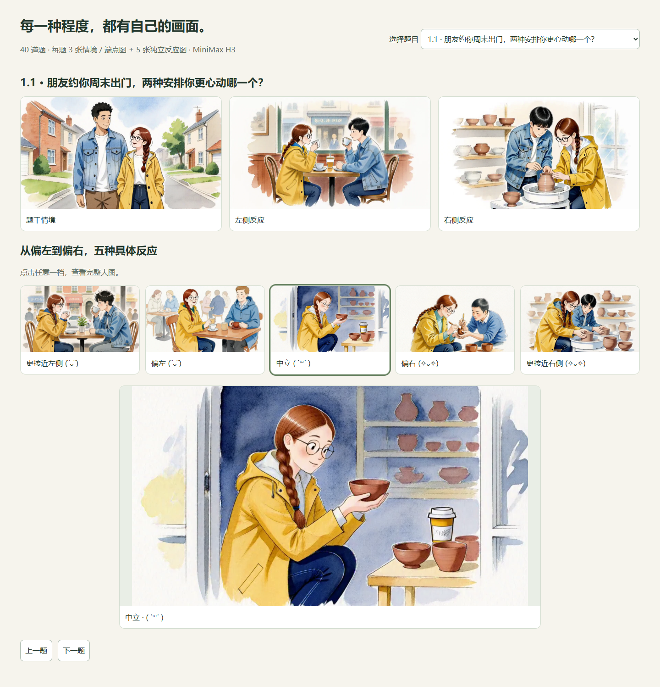

# 全题库写实图片更新

本轮重新生成全部 40 题、320 张图片，每题包含情境图、左右端点图和五档反应图。人物改为中国日常生活中的写实成年人，环境采用家居、餐桌、高铁、社区和工作室；通过实际动作、朝向、注意力和参与程度区分答案。网页继续只显示题干、程度标签、图片和颜文字，不显示解释句。

五档颜文字按原题计分方向逐档变化，左右端点也使用相同方向的表情。原选项顺序、五档数值及计分协议不变。图片可点击放大，替代文字仅供读屏使用。



[打开全部 40 题预览](五档题图预览.html) · [手机答题效果](assets/five-reactions-mobile.png)

## 生成与素材

- 全部情境和五档动作：`content/question-art-realistic-scenes.json`。
- 完整提示词：`content/question-art-realistic-prompts.json`；当前已安装图片的实际提示词：`content/question-art-production.json`。
- 定向补画：`content/question-art-realistic-refinements.json`，共 49 张，修正私下／公开交流、等待时的空座、专注自己／比较别人等容易混淆的画面。
- 原始生成服务：服务器本地 MiniMax H3 fl2va int8 + 8-step LoRA。基础批次为 `outputs/question-art-v10-realistic/`，补画为 `outputs/question-art-v11-realistic-refined/`。
- 最终图片：`public/question-art/`，共 320 张 1152×640 WebP。清单逐图保留实际生成任务 ID、随机种子、提示词 SHA-256、文件 SHA-256 和来源批次。
- 生成图中 20 处画面带出的字幕以审阅后的区域定位修补，保留完整构图。`content/question-art-realistic-cleanup.json` 保存区域和原图校验值；LaMa 修补输出在服务器 `outputs/question-art-v12-subtitle-clean/`，清单 `postprocess` 记录原图和修补模型校验值。修补只用于去除生成字幕，人物与场景由 MiniMax 生成。

## 复现与检查

```bash
node scripts/export_realistic_question_art.mjs
# 在既有 MiniMax 环境生成；使用新输出目录以保留旧任务
venv/bin/python generate_question_five.py \
  --prompts question-art-realistic-prompts.json --output outputs/question-art-new

# 本地校验下载，凭据仅从 ART_SSH_PASSWORD 环境变量读取
python scripts/sync_question_five.py --stage-only --watch
python scripts/install_realistic_question_art.py
python scripts/install_subtitle_cleanup.py
node scripts/export_question_review.mjs
python scripts/review_question_art.py
npm run media:questions
npm test
npm run test:e2e
npm run build
node scripts/verify_deployment.mjs
```

`install_realistic_question_art.py` 先验证基础图和补画的实际提示词、种子、格式与哈希，整套齐备后才安装到公开目录。`install_subtitle_cleanup.py` 验证修补区域、原图和输出哈希后更新清单及缓存版本。历史 v7 补画安装器会拒绝覆盖当前写实版本。

旧版题图和失败的修补试稿保存在本地 `.work/` 及服务器历史输出中，不进入网站发布目录。网站部署只读取当前清单列出的 320 张图片。
