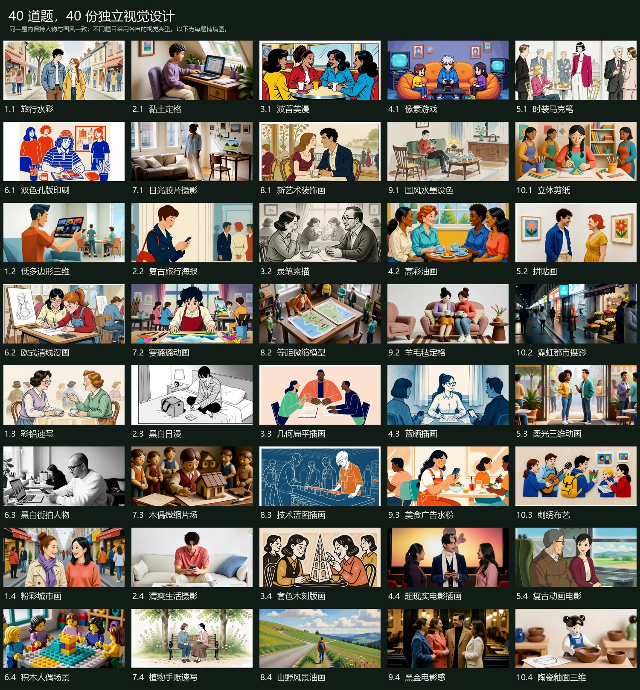
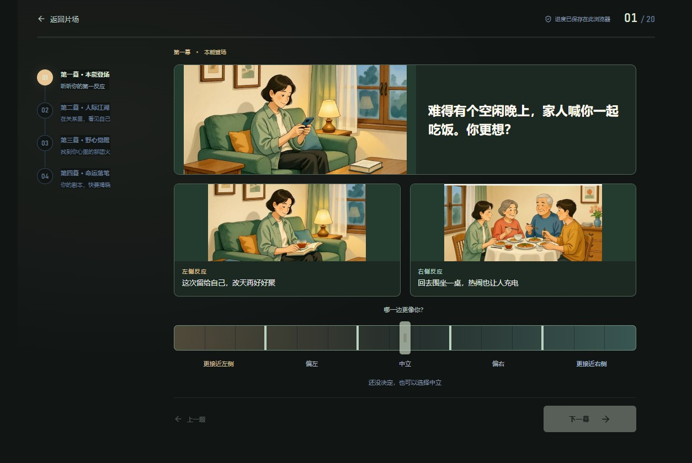

# 题目图片与自动播放

40 道题每题有三张图片，分别为情境、左侧反应和右侧反应。每题有自己的媒介、主角、服装、配色和场景设计；只有同一题的三张图需要保持一致。题目之间采用水彩、黏土定格、像素、美漫、摄影、水墨、剪纸、羊毛毡、木刻等不同视觉类型。网站每轮抽取 20 道，但素材覆盖全部题库。图片是服务器本地 MiniMax H3 实际生成的位图，前端不需要访问生成服务器。





[查看手机题目预览](assets/question-art-mobile.jpg)

## 素材与来源

- 成品：`public/question-art/<题号，以短横线代替点>/scene.webp`、`left.webp`、`right.webp`。
- 同一题先生成三格分镜，再裁切为三张 1136 × 556 的 WebP，确保角色、服装和画风相近。图片里的细微差别不替代文字语义；页面保留原题干和选项作为说明。
- 服务：`connect.nma1.seetacloud.com:49880`，运行目录 `/root/autodl-tmp/minimax-h3`。未在源码或前端中保存登录密码。
- 模型：MiniMax H3 fl2va int8，8 步 LoRA；ComfyUI 以 1152 × 1728、最小 5 帧生成分镜，仅导出首帧，无需生成新角色视频。
- 当前多样画风版本的原始分镜和工作流保留在服务器 `outputs/question-art-v4/` 与 `outputs/question-art-v5/`，逐题来源以 `content/question-art-selection.json` 为准。原先全库采用相近画风的 v2/v3 仅作历史备份。
- `content/question-art-directions.json` 保存 40 份独立视觉设计。人物与画风约束按题号读取，不能再把一个人物或一种媒介放进全库共用提示词中。
- `content/question-art-production.json` 是最终采用图片的实际完整提示词、随机种子、任务编号及原题文案；`public/question-art/manifest.json` 记录文件大小、尺寸、SHA-256 和来源版本。

## 重新生成

在 `content/question-art-scenes.json` 中修改情境和动作，在 `content/question-art-directions.json` 中修改对应题目的画风、人物与配色，再执行 `node scripts/export_question_art.mjs` 导出新的提示词方案。需要重现最终采用版本时直接使用 `content/question-art-production.json`。

将提示词 JSON 和 `scripts/generate_question_art.py` 复制到上述服务器运行目录，然后使用现有环境：

```bash
venv/bin/python generate_question_art.py \
  --prompts question-art-production.json \
  --output outputs/question-art-new \
  --only 9.1
```

省略 `--only` 会处理全部 40 题。生成器保留每题工作流，已存在 `complete.json` 的题目会跳过；重新出图请使用新的输出目录。先检查原始三格分镜、左右选项的行为和人物一致性，再同步三张 WebP，并更新清单。

## 页面行为

图片直接映射题号和原有 A/B 顺序。点击左图选 0、右图选 14；15 档滑杆、键盘、返回修改、进度保存及采集协议不变。只预加载下一题的三张图，不一次加载完整题库。缺图时保留文字、按钮和滑杆。图片 URL 附带从素材内容计算的版本号，更新成品后刷新页面即可获取新图。

只有最后一题确认成功后，经过揭晓页才自动弹出匹配角色的现有短片。保留现有默认开启声音的行为，并设置 `playsInline`；自动播放被浏览器阻止时，显示播放按钮，用户也可切换静音。视频加载失败可重试。关闭后保留完整结果，刷新或重新打开结果不反复弹窗。此功能不是每次调整滑杆后播放视频。采集服务缺失或已确认的答题记录丢失时，保留原有重新加载或重新开始的恢复流程，不跳过记录校验。

## 验证与发布

```bash
npm run media:questions
npm test
npm run test:e2e
npm run build
```

浏览器测试覆盖全部 120 张图解码、图片点击左右方向、图片失败、自动播放与被阻止后的手动播放、20 题流程，以及全部 40 题在 320 × 568 / 390 × 844 屏幕的布局。

第一版交互验收：19 项单元测试通过；浏览器完整套件 46 项通过、3 项设备条件跳过；构建产物另通过 6 项素材及完整答题/播放检查。画风调整后的验证另覆盖全部素材、独立视觉设计与原题对应关系、缓存更新、图片失败回退及自动播放。

构建目录为 `dist/`，其中必须包含 `question-art/`。Vite 在现有发布白名单基础上，仅复制当前清单中的 120 张题图及 manifest；旧素材与无关文件仍不进入构建。如果使用外部 NBTI 根项目自定义部署脚本，除了 `assets/`、`media/` 等目录，也需同步 `question-art/`，并更新根服务的 `data/public-assets.json` 和 Nginx 精确文件清单。GitHub 源码推送不会自动更新外部 NBTI 生产服务器。

本仓库的 `scripts/package_site.py` 已包含题图目录并校验 ZIP 内全部题图哈希；`scripts/verify_deployment.mjs` 同样检查构建目录内 120 张图的完整性。
